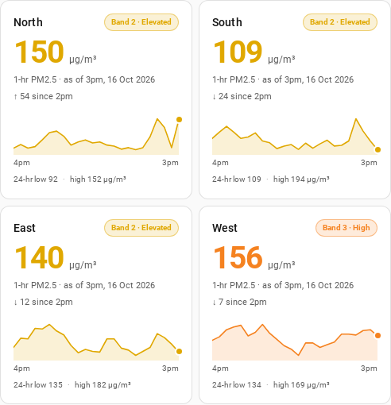

# Haze PM2.5 Card for Home Assistant

[](https://hacs.xyz)
[](https://github.com/leejunkit/homeassistant-sg-haze-card/actions/workflows/validate.yml)
[](LICENSE)

A self-contained [Lovelace](https://www.home-assistant.io/dashboards/) card that shows
Singapore's **1-hour PM2.5** reading for one region, with a prominent current value
and a **24-hour trend line**.

Data comes straight from the Singapore government's public haze API:

```
GET https://www.haze.gov.sg/api/airquality/jsondata/<unix timestamp>
```

where `<unix timestamp>` is the current local time floored to the nearest 5 minutes.

The card needs **no integration, no sensors and no recorder history** — every API
response already contains the last 24 hourly readings, so the trend line is
populated the moment the card loads.



## Install

### HACS (recommended)

1. In Home Assistant, go to **HACS → ⋮ → Custom repositories**.
2. Add this repository's URL and choose category **Dashboard**.
3. Search for **Haze PM2.5 Card** in HACS and install it.
4. Reload your browser.

Because `hacs.json` declares a `filename`, HACS registers the dashboard resource
for you — you can skip straight to [Usage](#usage).

[](https://my.home-assistant.io/redirect/hacs_repository/?owner=leejunkit&repository=homeassistant-sg-haze-card&category=plugin)

### Manual

1. Copy `dist/haze-card.js` into your Home Assistant `config/www/` folder:

   ```sh
   cp dist/haze-card.js /path/to/homeassistant/config/www/haze-card.js
   ```

2. Register it as a frontend resource.

   **UI** — Settings → Dashboards → ⋮ → Resources → Add resource:

   | Field | Value |
   |---|---|
   | URL | `/local/haze-card.js` |
   | Resource type | JavaScript module |

   **YAML** — in `configuration.yaml`:

   ```yaml
   lovelace:
     resources:
       - url: /local/haze-card.js
         type: module
   ```

3. Hard-refresh the browser (Ctrl/Cmd + Shift + R) so the new resource is picked up.

## Usage

Add a card for each region you care about:

```yaml
type: custom:haze-pm25-card
region: north
```

A typical four-region layout:

```yaml
type: grid
columns: 2
square: false
cards:
  - type: custom:haze-pm25-card
    region: north
  - type: custom:haze-pm25-card
    region: south
  - type: custom:haze-pm25-card
    region: east
  - type: custom:haze-pm25-card
    region: west
```

### Options

| Option | Type | Default | Description |
|---|---|---|---|
| `region` | string | `north` | One of `north`, `south`, `east`, `west`, `central`. |
| `title` | string | region name | Override the heading shown on the card. |
| `hours` | integer (2–24) | `24` | How many hours to plot. |
| `show_graph` | boolean | `true` | Set to `false` for a value-only card. |

## What it shows

- **Current value** — the latest 1-hour PM2.5 reading in µg/m³, tinted with its band colour.
- **Band chip** — NEA's 1-hour PM2.5 band, e.g. `Band 2 · Elevated`.
- **Change** — the delta against the previous hour.
- **Trend line** — the last 24 hourly readings drawn from the API's own time series,
  with a low/high summary underneath.
- **Severity bands** — the plot background is shaded with NEA's four bands
  (Normal / Elevated / High / Very High) on a fixed 25–250 µg/m³ scale, so every
  card's bands sit at the same height and regions can be compared directly.

### NEA 1-hour PM2.5 bands

| 1-hour PM2.5 (µg/m³) | Band | Descriptor |
|---|---|---|
| 0 – 55 | 1 | Normal |
| 56 – 150 | 2 | Elevated |
| 151 – 250 | 3 | High |
| ≥ 251 | 4 | Very High |

The band is read from the API response rather than computed locally, so it always
matches what haze.gov.sg reports.

## How it works

- The card computes the API timestamp itself by flooring the browser's local time
  to the nearest 5 minutes, then calls `haze.gov.sg` directly. The API returns
  `Access-Control-Allow-Origin: *`, so the browser is allowed to call it cross-origin.
  This matches [haze.gov.sg's own `timestamp`](https://www.haze.gov.sg/api/UnixTime/GetTime/),
  which flattens the time to 5-minute buckets.
- Each response contains a 24-hour series per region under `Chart1HRPM25`, so the
  graph needs no stored history.
- The card refreshes shortly after every 5-minute slot begins, and when the dashboard
  becomes visible again. If the newest data isn't published yet it walks back up to
  three hours before showing an error.
- If nothing can be fetched, the card shows an *Unavailable* state with a **Retry**
  button.

## Development

The card is plain ES2020 with no build step and no dependencies.

Run the unit/render tests (uses jsdom via Docker, no local Node required):

```sh
docker run --rm -v "$PWD":/src:ro -w /app node:20-alpine \
  sh -c "cp -r /src/. /app/ && npm i --silent jsdom@24 && node tests/render.test.mjs"
```

Run the end-to-end test: it boots a throwaway Home Assistant and a headless
Chromium, onboards, opens a dashboard using the card, and checks that live data
renders. The screenshot above is produced by this run.

```sh
tests/sandbox/run.sh
```

`tests/fixture.json` is a recorded API response used by the unit tests. Refresh it
with:

```sh
ts=$(( $(date +%s) / 300 * 300 ))
curl -s "https://www.haze.gov.sg/api/airquality/jsondata/$ts" -o tests/fixture.json
```

## Releasing (maintainers)

HACS uses the **tag of the latest published GitHub release** as the version. A tag
alone is not enough — you must also publish a release.

```sh
git init
git add .
git commit -m "Haze PM2.5 card v1.0.0"
git branch -M main
git remote add origin https://github.com/leejunkit/homeassistant-sg-haze-card.git
git push -u origin main

git tag -a v1.0.0 -m "v1.0.0"
git push origin v1.0.0
```

Then on GitHub: **Releases → Draft a new release → select the `v1.0.0` tag →
Publish release**.

### Repository settings

Set these on GitHub so the [`hacs/action`](.github/workflows/validate.yml) check passes
with no ignores:

- **Description** — e.g. "Singapore 1-hour PM2.5 Lovelace card".
- **Topics** — at least `home-assistant`, `hacs`, `lovelace`, `hass`, `singapore`.
- **Issues** — enabled.
- Keep the repository **public** and **not archived**.
- Keep a recognised license file (`LICENSE`), and at least one image in this README.

To be listed in the default HACS store, open a PR adding this repository to the
`plugin` file in [hacs/default](https://github.com/hacs/default), once the action
above is green and a release exists.

## Notes

- Readings are published hourly, but the card re-fetches every 5 minutes (mirroring
  haze.gov.sg) so it picks up new data promptly. A value is always "as of" the
  previous hour; the card labels this and dims the value if the data is more than
  three hours old.
- This project is not affiliated with NEA. Data source:
  [haze.gov.sg](https://www.haze.gov.sg/).
